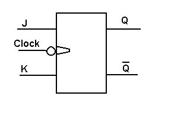

The aim of this experiment is to understand and build the basic memory elements of sequential digital circuits: the RS flip-flop (a clocked SR latch), the D flip-flop, the master-slave JK flip-flop and the T flip-flop, and to verify their behaviour for a given clock.

### What you will learn:

Through this interactive experiment, you will:

- **Understand the fundamentals** of sequential logic circuits and memory elements
- **Analyze** the basic SR latch (NOR and NAND versions) and the gated SR latch, and see why a clock input is added
- **Construct an RS flip-flop** from logic gates and a clock (Practice task 1)
- **Build a D flip-flop** from an RS flip-flop (Practice task 2)
- **Build a JK flip-flop in the master-slave configuration** from NAND gates and see how it avoids the race-around condition (Practice task 3)
- **Build a T flip-flop** from a JK flip-flop (Practice task 4)
- **Learn the timing terms** setup time, hold time and propagation delay (described in the theory)
- **Investigate real-world applications** of flip-flops in registers, counters, and memory systems

### Why are latches and flip-flops important?

Latches and flip-flops are fundamental building blocks of sequential digital systems. They serve as the basic memory elements that enable computers to store and process information over time. These circuits are essential components not only in memory units and registers, but also throughout processors for state storage, synchronization, and control operations. Understanding latches and flip-flops will give you insight into how digital systems maintain state and coordinate operations across clock cycles.

_The symbol of a JK flip-flop. The small circle at the clock input means that the flip-flop is triggered by the falling edge of the clock._
