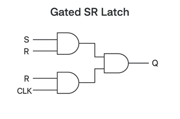
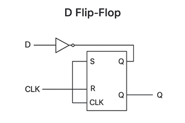
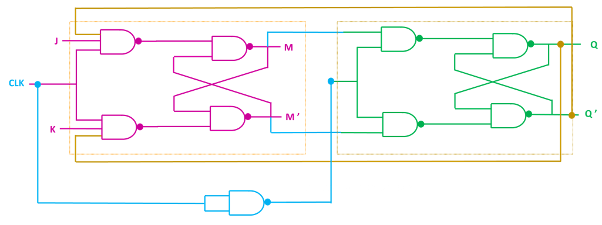
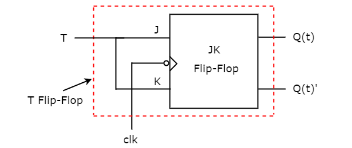

### Demo

The Demo has one page for each flip-flop: RS, D, JK and T. Use the tabs at the top to move between them.

1. Click on an input bit to toggle its value between 0 and 1. The clock bit has to be 1 to start.
2. Click on **Start** to apply a clock pulse. The input values travel through the gates and the output bits Q and Q' show the new state. The same button pauses and resumes the run, and the speed can be changed (1x, 2x, 4x).
3. The output bits Q and Q' show the stored state from the beginning. The circuit starts in the SET state, Q = 1 and Q' = 0, and **keeps its state from one run to the next**. Change the inputs and click on **Start** again to apply another clock pulse.
4. **Reset** puts the inputs back to their starting values and the circuit back in the SET state.

The observations panel tells you what the flip-flop did (hold, set, reset or toggle) and shows the old and the new value of Q.

### Practice

The Practice page has four tasks, one for each tab. In every task the input bits, the clock Clk and the output bits Q and Q' are already on the circuit board, and you build the flip-flop between them.

#### General instructions

- Click on a component in the **Components** panel to add it to the board, drag it to move it, and connect components by dragging from one endpoint (the dots on the components) to another. A wire can be dragged from an output point to an input point or the other way round. An output point can drive several inputs.
- To delete a wire or a component, right click on it and select **Delete**.
- Click on an input bit to toggle it between 1 and 0. The clock Clk is a separate input: its value changes by itself while the simulation runs.
- **Every task starts in the SET state, Q = 1 and Q' = 0.**
- Click on **Simulate** to start the clock Clk (0.5 Hz). The output bits follow your circuit while you change the input bits. The button now reads **Stop**: click on it to stop the clock. **Reset** stops the clock too, and so does a change of tab. The **Submit** button works only when the clock is stopped.
- Click on **Submit** to check the circuit. A "Success" or "Fail" message and a truth table with the expected and the observed values of Q and Q' are shown. The circuit must be completely connected, otherwise the component that is not connected properly is highlighted.

#### Task 1: RS Flip-Flop

_Figure 1: RS Flip-Flop (gated SR latch) with the clock as enable input E. The figure uses AND and NOR gates; a version with four NAND gates works in the same way. Reference: Theory section_

**Components required:** 4 NAND gates (or 2 AND gates and 2 NOR gates).

**Circuit connections (NAND version):**

1. Drag the first NAND gate and connect its inputs with S and Clk. Its output is S'.
2. Drag the second NAND gate and connect its inputs with R and Clk. Its output is R'.
3. Drag the third NAND gate and connect its inputs with the output of the first NAND gate and the output of the fourth NAND gate. Connect its output with the Q output bit.
4. Drag the fourth NAND gate and connect its inputs with the output of the second NAND gate and the output of the third NAND gate. Connect its output with the Q' output bit.

**Circuit connections (AND and NOR version):**

1. Connect the inputs of the first AND gate with R and Clk, and the inputs of the second AND gate with S and Clk.
2. Connect the inputs of the first NOR gate with the output of the first AND gate and the output of the second NOR gate. Connect its output with the Q output bit.
3. Connect the inputs of the second NOR gate with the output of the second AND gate and the output of the first NOR gate. Connect its output with the Q' output bit.

**Expected behaviour** (checked when you click on "Submit", starting from Q = 1 and Q' = 0):

| R | S | Clk | Q | Q' | Operation                  |
| - | - | --- | - | -- | -------------------------- |
| 0 | 0 | 0   | 1 | 0  | Hold                       |
| 0 | 1 | 0   | 1 | 0  | Hold (clock low)           |
| 1 | 0 | 0   | 1 | 0  | Hold (clock low)           |
| 1 | 1 | 0   | 1 | 0  | Hold (clock low)           |
| 1 | 0 | 1   | 0 | 1  | Reset                      |
| 0 | 0 | 1   | 0 | 1  | Hold                       |
| 0 | 1 | 1   | 1 | 0  | Set                        |

The flip-flop responds to S and R only while Clk = 1. The combination S = R = 1 with Clk = 1 is not allowed.

#### Task 2: D Flip-Flop

_Figure 2: D Flip-Flop built from an SR flip-flop and a NOT gate. Reference: Theory section_

**Components required:** 1 RS Flip-Flop block (S is its upper input, R the lower input, the clock is the middle input marked with a triangle, Q is the upper output and Q' the lower output) and 1 NOT gate.

**Circuit connections:**

1. Drag the RS Flip-Flop block and the NOT gate onto the board.
2. Connect D with the S input of the RS Flip-Flop block and with the input of the NOT gate.
3. Connect the output of the NOT gate with the R input of the RS Flip-Flop block.
4. Connect Clk with the clock input of the RS Flip-Flop block.
5. Connect the Q output of the block with the Q output bit and its Q' output with the Q' output bit.

**Expected behaviour:**

| D | Clk | Q | Q' | Operation          |
| - | --- | - | -- | ------------------ |
| 0 | 0   | 1 | 0  | Hold (clock low)   |
| 1 | 0   | 1 | 0  | Hold (clock low)   |
| 0 | 1   | 0 | 1  | Q follows D        |
| 1 | 1   | 1 | 0  | Q follows D        |
| 0 | 0   | 1 | 0  | Hold (clock low)   |

#### Task 3: JK Flip-Flop (master-slave)

_Figure 3: Master-Slave JK Flip-Flop. The master latch (left) takes over J and K while the clock is high, the slave latch (right) copies the master when the clock is low. Reference: Theory section_

**Components required:** 2 three-input NAND gates (3-NAND), 6 NAND gates and 1 NOT gate.

**Circuit connections:**

*Master latch:*

1. Drag the first 3-NAND gate and connect its inputs with J, Clk and the Q' output (the output of the last NAND gate of step 9). Call its output A.
2. Drag the second 3-NAND gate and connect its inputs with K, Clk and the Q output (the output of the NAND gate of step 8). Call its output B.
3. Drag a NAND gate (M) and connect its inputs with A and the output of the NAND gate of step 4.
4. Drag a NAND gate (M') and connect its inputs with B and the output of M.

*Slave latch:*

5. Drag the NOT gate and connect its input with Clk. Its output is the inverted clock.
6. Drag a NAND gate (C) and connect its inputs with M and the inverted clock.
7. Drag a NAND gate (D) and connect its inputs with M' and the inverted clock.
8. Drag a NAND gate (Q) and connect its inputs with C and the output of the NAND gate of step 9. Connect its output with the Q output bit (and with the second 3-NAND gate, step 2).
9. Drag a NAND gate (Q') and connect its inputs with D and the output of Q. Connect its output with the Q' output bit (and with the first 3-NAND gate, step 1).

**Expected behaviour.** When you click on "Submit", every row with a clock pulse applies Clk = 1 and then Clk = 0, and Q is read after the pulse:

| J | K | Clk  | Q | Q' | Operation                |
| - | - | ---- | - | -- | ------------------------ |
| 0 | 0 | 0    | 1 | 0  | Hold (no clock pulse)    |
| 0 | 1 | 0    | 1 | 0  | Hold (no clock pulse)    |
| 1 | 0 | 0    | 1 | 0  | Hold (no clock pulse)    |
| 1 | 1 | 0    | 1 | 0  | Hold (no clock pulse)    |
| 0 | 1 | 1→0  | 0 | 1  | Reset                    |
| 0 | 0 | 1→0  | 0 | 1  | Hold                     |
| 1 | 0 | 1→0  | 1 | 0  | Set                      |
| 1 | 1 | 1→0  | 0 | 1  | Toggle                   |
| 1 | 1 | 1→0  | 1 | 0  | Toggle                   |

A single gated JK latch (a latch with J, K and the clock but without the master-slave arrangement) does not pass this task: with J = K = 1 and Clk = 1 its output keeps changing (race-around condition).

#### Task 4: T Flip-Flop

_Figure 4: T Flip-Flop built from a JK Flip-Flop with J and K tied together. Reference: Theory section_

**Components required:** 1 JK Flip-Flop block (J is its upper input, K the lower input, the clock is the middle input, Q is the upper output and Q' the lower output).

**Circuit connections:**

1. Drag the JK Flip-Flop block onto the board.
2. Connect T with both the J input and the K input of the block.
3. Connect Clk with the clock input of the block.
4. Connect the Q output of the block with the Q output bit and its Q' output with the Q' output bit.

**Expected behaviour:**

| T | Clk | Q | Q' | Operation                |
| - | --- | - | -- | ------------------------ |
| 0 | 0   | 1 | 0  | Hold (clock low)         |
| 1 | 0   | 1 | 0  | Hold (clock low)         |
| 0 | 1   | 1 | 0  | Hold                     |
| 1 | 1   | 0 | 1  | Toggle                   |
| 1 | 1   | 1 | 0  | Toggle                   |
| 0 | 1   | 1 | 0  | Hold                     |

#### Observations

- With the clock low, none of the flip-flops changes its output, whatever the inputs are.
- The RS flip-flop sets (S = 1, R = 0), resets (S = 0, R = 1) or holds (S = R = 0) its output when the clock is applied.
- The D flip-flop copies D to Q when the clock is applied, so the invalid input S = R = 1 of the RS flip-flop cannot happen.
- The JK flip-flop has all four operations (hold, set, reset, toggle); the master-slave arrangement makes it toggle once per clock pulse.
- The T flip-flop toggles on every clock pulse when T = 1, so Q changes at half the frequency of the clock.
- If a circuit has been built correctly, a "Success" message is displayed upon clicking "Submit".

#### Troubleshooting

- **"Highlighted component not connected properly"**: every input and every output of every component has to be connected, and the output bits Q and Q' have to be driven by the circuit.
- **The simulation does not seem to stop**: click on the "Stop" button (the Simulate button while the clock runs), or on Reset.
- **Submit does not respond**: Submit is disabled while the clock runs. Stop the simulation first.
- **Task 1 or 3 fails in the first rows**: remember that the circuit starts with Q = 1 and Q' = 0 and that the Q' output has to be fed back as described.
- **Task 3 fails only in the two toggle rows**: the circuit is probably a single gated latch. Add the slave latch and the inverted clock.
